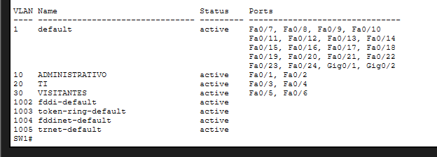
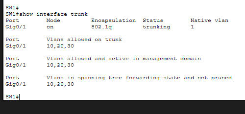
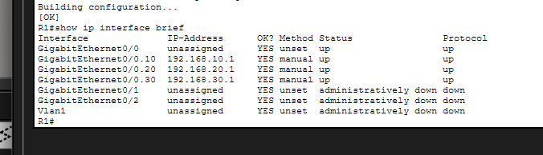
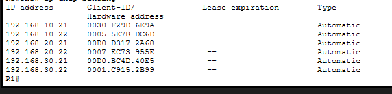
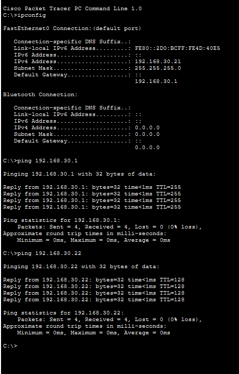
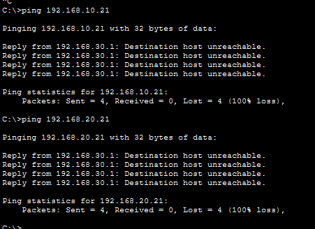
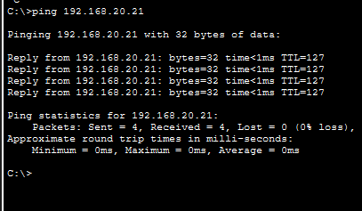
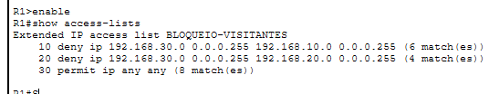

# Laboratório de rede empresarial
Projeto pessoal de infraestrutura e redes desenvolvido no Cisco Packet Tracer.

## Objetivo
Simular a rede de uma pequena empresa, separando Administrativo, TI e Visitantes em VLANs, com endereçamento automático e restrição de acesso às redes internas.

## Equipamentos
- 1 roteador Cisco 2911 (R1).
- 1 switch Cisco 2960-24TT (SW1).
- 6 computadores: dois por setor.

## Topologia e conexões
O SW1 conecta os computadores e mantém a separação em VLANs. O enlace trunk transporta as três VLANs até o R1. O roteador utiliza subinterfaces para atuar como gateway de cada rede, fornecer DHCP e aplicar a ACL.

| Dispositivo | Porta | Conexão no SW1 |
|---|---|---|
| R1 | Gi0/0 | Gi0/1 — trunk |
| ADM-01 | FastEthernet0 | Fa0/1 — access VLAN 10 |
| ADM-02 | FastEthernet0 | Fa0/2 — access VLAN 10 |
| TI-01 | FastEthernet0 | Fa0/3 — access VLAN 20 |
| TI-02 | FastEthernet0 | Fa0/4 — access VLAN 20 |
| VIS-01 | FastEthernet0 | Fa0/5 — access VLAN 30 |
| VIS-02 | FastEthernet0 | Fa0/6 — access VLAN 30 |


## Endereçamento
| Setor | VLAN | Rede | Gateway | DHCP disponível |
|---|---|---|---|---|
| Administrativo | 10 | 192.168.10.0/24 | 192.168.10.1 | 192.168.10.21–254 |
| TI | 20 | 192.168.20.0/24 | 192.168.20.1 | 192.168.20.21–254 |
| Visitantes | 30 | 192.168.30.0/24 | 192.168.30.1 | 192.168.30.21–254 |

Máscara em todas as redes: 255.255.255.0. Os endereços de .1 a .20 foram excluídos da distribuição DHCP para uso em gateways e futuros equipamentos com IP fixo. Durante os testes, cada setor recebeu os endereços .21 e .22.

## Implementação
1. Criação das VLANs 10, 20 e 30 no switch.
2. Associação das portas dos PCs às respectivas VLANs em modo access.
3. Configuração da Gi0/1 do SW1 como trunk 802.1Q, permitindo as VLANs 10, 20 e 30.
4. Ativação da Gi0/0 do roteador.
5. Criação das subinterfaces Gi0/0.10, Gi0/0.20 e Gi0/0.30, com encapsulamento 802.1Q e os gateways correspondentes (router-on-a-stick).
6. Criação de um pool DHCP por rede no R1.
7. Aplicação da ACL BLOQUEIO-VISITANTES na entrada da Gi0/0.30.
8. Testes de conectividade e salvamento das configurações.

## Controle de acesso
A ACL é processada de cima para baixo e bloqueia os pacotes com origem na rede de Visitantes e destino nas redes de Administrativo e TI. Os demais pacotes são permitidos.

```text
ip access-list extended BLOQUEIO-VISITANTES
 deny ip 192.168.30.0 0.0.0.255 192.168.10.0 0.0.0.255
 deny ip 192.168.30.0 0.0.0.255 192.168.20.0 0.0.0.255
 permit ip any any

interface gigabitEthernet 0/0.30
 ip access-group BLOQUEIO-VISITANTES in
```

A wildcard 0.0.0.255 corresponde a todos os endereços da rede /24. A direção in filtra pacotes que entram no roteador pela subinterface de Visitantes.

Esta ACL não acompanha o estado das conexões. Ela também bloqueia respostas de Visitantes destinadas às redes internas; por isso, pings iniciados por ADM ou TI para os visitantes também falham.

## Validação
Antes da aplicação da ACL, o ADM-01 (192.168.10.21) alcançou o próprio gateway, o outro computador do setor e os quatro computadores das outras VLANs.

Após a aplicação da ACL, os testes foram confirmados como bem-sucedidos no laboratório, conforme a política abaixo:

| Origem | Destino | Resultado esperado e confirmado no laboratório |
|---|---|---|
| Visitantes | Gateway 192.168.30.1 | Permitido |
| Visitantes | Outro PC visitante | Permitido |
| Visitantes | PC do Administrativo | Bloqueado |
| Visitantes | PC da TI | Bloqueado |
| Administrativo | PC da TI | Permitido |

A saída de show access-lists registrou:
- Regra 10: 8 correspondências no bloqueio para Administrativo.
- Regra 20: 4 correspondências no bloqueio para TI.
- Regra 30: 4 correspondências na permissão dos demais pacotes.

Esses valores são uma captura do momento dos testes e podem aumentar com novas tentativas.

### Evidências da configuração
Capturas obtidas durante a montagem e validação do laboratório:

**VLANs e portas do switch**


**Trunk com as VLANs 10, 20 e 30**


**Gateways e subinterfaces ativos**


**Seis concessões DHCP**


### Evidências dos testes após a ACL

**Visitantes: gateway e outro visitante acessíveis (0% de perda)**


**Visitantes: acesso a Administrativo e TI bloqueado**
O gateway 192.168.30.1 retorna `Destination host unreachable` para os destinos 192.168.10.21 e 192.168.20.21.


**Administrativo para TI: comunicação preservada (0% de perda)**
Teste executado a partir do Administrativo para 192.168.20.21.


**Contadores da ACL**
Nesta nova captura, a regra 10 apresenta 6 correspondências, a regra 20 apresenta 4 e a regra 30 apresenta 8. São valores de outra sessão de testes; os contadores não representam totais históricos permanentes.


### Comandos de verificação
No SW1:
```text
show vlan brief
show interfaces trunk
```

No R1:
```text
show ip interface brief
show ip dhcp binding
show access-lists
show ip route
```

Nos PCs:
```text
ipconfig
ping 192.168.30.1
ping 192.168.10.21
ping 192.168.20.21
```

Os comandos de ping devem ser escolhidos conforme a origem do teste. Primeiras tentativas podem apresentar perdas durante a resolução ARP; aguardar o término e repetir ajuda a distinguir esse comportamento de uma falha persistente.

## Dificuldades e aprendizados
- Diferenciar os modos do IOS: > (usuário), # (privilegiado) e (config)# (configuração global).
- Usar enable antes de configure terminal.
- Entender que a criação de VLANs separa os domínios de broadcast, enquanto o roteamento permite comunicação entre redes e a ACL restringe os acessos.
- Relacionar os contadores da ACL às tentativas de comunicação.

## Limitações
- Não há conexão com internet simulada, NAT ou serviço DNS configurado.
- A ACL implementa filtragem IPv4 por endereços, sem inspeção de estado.
- Os dois visitantes podem se comunicar entre si na mesma VLAN.
- Este é um laboratório didático; não representa uma configuração completa de segurança para produção.

## Arquivos do repositório
- README.md: documentação.
- [projeto-rede-empresa.pkt](projeto-rede-empresa.pkt): simulação salva.
- [imagens/](imagens/): capturas de validação de VLANs, trunk, interfaces e DHCP.
- [configs/R1.txt](configs/R1.txt): configuração do roteador obtida com `show running-config`.
- [configs/SW1.txt](configs/SW1.txt): configuração do switch obtida com `show running-config`.

As exportações preservam os comandos fornecidos, com espaçamento e separadores redundantes normalizados. No SW1, a saída não inclui as definições das VLANs armazenadas na base de VLANs; consulte a tabela de endereçamento e a captura de `show vlan brief` para os IDs e nomes. Para recriar o switch, crie as VLANs 10 (ADMINISTRATIVO), 20 (TI) e 30 (VISITANTES) antes de validar as portas.

## Como reproduzir
1. Abrir projeto-rede-empresa.pkt no Packet Tracer.
2. Aguardar a convergência dos enlaces.
3. Conferir DHCP nos PCs em Desktop → IP Configuration.
4. Verificar os endereços com ipconfig.
5. Executar os testes da tabela de validação e consultar os contadores da ACL.

## Próximas melhorias
- Adicionar servidor DNS e HTTP para testar acesso a serviços.
- Simular uma conexão externa com roteamento e NAT.
- Configurar acesso de administração por SSH.
- Desativar portas não utilizadas e estudar proteção das portas de acesso.

